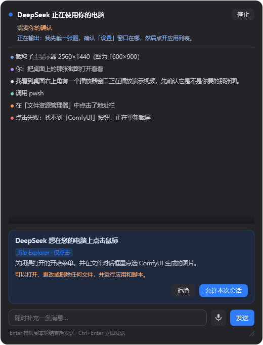

# DSH-Computer-Use

让模型直接操作这台 Windows 电脑的 DSH 插件：看屏幕、点按钮、拖窗口、打字、按快捷键，全部通过结构化接口完成，而不是让模型对着一张图猜坐标。

核心原则只有一条：**先读结构，再读文字，最后才看像素**——UI 自动化树（`computer_look`）→ OCR（`computer_ocr`）→ 截图（`computer_screenshot`）。一张截图约 1.8k token，一行 OCR 约 15 token，顺序反了既慢又贵。



> 这是一个 **DeepSeek Harness（DSH）插件**，单独安装没有意义；只支持 Windows。

[安装](#安装五步) · [安全与隐私](#安全与隐私) · [工具](docs/TOOLS.md) · [设置](docs/SETTINGS.md) · [架构](docs/ARCHITECTURE.md) · [English](#english)

## 它解决什么

- **看得省**：优先读控件树，树太薄才退到 OCR，最后才截图；截图可以只拍一个窗口、一块区域，或放大某处。
- **点得准**：可以按控件名点（`target`）、按一行文字点（`anchor`），纯坐标点击前会吸附到附近唯一控件的中心；点完回报**实测落点**和**命中的控件**，落点不在目标内会明说。
- **批量做**：一连串已经想好的步骤塞进 `computer_sequence`（默认上限 24 步），一趟只拍一张图。
- **看得见、也关得掉**：蓝边、状态条、截图预览、目标框、落点光圈、提示、卡片、停靠，各自一个开关；「纯净模式」一键全部熄灭，只操作电脑、屏幕上什么都不画。
- **随时刹车**：`Ctrl+Alt+Q` 暂停，暂停时所有点击/按键/滚动/输入都被拒绝；聊天里 `/pause`、`/pause off` 同样有效。

## 要求

| 项 | 要求 |
| --- | --- |
| 系统 | Windows 10（1809+）/ Windows 11，x64 |
| 宿主 | 已安装 [DeepSeek Harness](https://github.com/deepseek-ai) 并能打开 Web GUI |
| PowerShell | 5.1（系统自带；插件用它截屏、走 UI 自动化、注入输入） |
| Node.js | 20+（DSH 自带运行时，通常不需要另装） |

## 安装（五步）

把下面这段连同报错一起交给 AI，它也能自己装：

1. 克隆仓库到本地，记下绝对路径，例如 `D:\tools\dsh-computer-use-windows`：

   ```powershell
   git clone https://github.com/kUROITORIII/dsh-computer-use.git
   ```

2. 打开 profile 的 `package.json`（一般在 `%DSH_HOME%\profiles\desktop\package.json`），在 `dependencies` 里加一行，指向你刚克隆的目录：

   ```json
   "dsh-computer-use-windows": "link:D:/tools/dsh-computer-use-windows"
   ```

3. 在同一个 profile 目录执行依赖安装（用 DSH 自带的 pnpm）：

   ```powershell
   pnpm install
   ```

4. **重启 DSH**（关掉进程再开，不是按 Ctrl+R）。插件行来自包里的 `cordis.patch.yml`，只在启动时读。

5. 打开侧栏「插件」，应该能看到 **DSH-Computer-Use**；点开它、再点「包含的组件」里的组件名，就是设置页。

验证装好了：在聊天里让模型「截一张图」，屏幕上出现卡片/光边，说明工具已注册。

## 第一次用：三个开关值得先看

- **危险动作要不要先问**（`approval`）：公开默认 `once-per-session`——第一次针对某个程序操作前问一次；确认「这个会话里都听你的」之后不再打断。想完全不打断就改成 `never`。
- **暂停热键**：`Ctrl+Alt+Q`。记住它，这是你唯一的硬刹车。
- **截图存哪**：默认 `%TEMP%\dsh-computer-use\shots`，保留最近 50 张；可以在设置页改成任意目录，或把保留数设成 0（读完就删）。

## 它会往屏幕上画什么（每一项都能单独关）

| 元素 | 默认 | 说明 |
| --- | --- | --- |
| 蓝边（屏幕四周光带） | 开 | 表示「正在操作这台电脑」 |
| 状态条 | 开 | 停在窗口上沿的一行进度 |
| 截图预览小窗 | 开 | 把拍到的画面浮出来；关掉不弹，但截图照常 |
| 控制卡片 / 停靠窗口 | 开 | 说明、进度、权限询问、回复框 |
| 目标窗口边框 | 开 | 正在操作的那个窗口加一圈边 |
| 点击落点光圈 | 开 | 点击前在落点闪一个圈 |
| 居中提示 | 开 | 一次性提示「正在使用你的电脑」，文案可改 |
| 纯净模式 | 关 | 一键熄灭上面全部，且不缩停靠窗口 |

## 安全与隐私

- **它能接管整台电脑**：鼠标、键盘、剪贴板、窗口都属于它可操作的范围。默认每会话问一次；权限设为 `never` 就等于完全信任。
- **不联网**：插件本身不发任何网络请求，不做遥测；OCR、截图、UI 自动化全部在本机完成。
- **写盘只有这几处**：`%TEMP%\dsh-computer-use\`（截图、日志）、`%DSH_HOME%\`（启动戳、进度日志、点击日志）、以及你配置的截图目录。
- **随时可停**：`Ctrl+Alt+Q`；在插件页关掉那一行，19 个工具立刻消失，两个 PowerShell 进程退出，热键注销，设置保留。
- 截图可能包含屏幕上的隐私内容：默认只留 50 张，且都在临时目录；在意的话把保留数设成 0。

## 工具一览（19 个）

| 分类 | 工具 | 用途 |
| --- | --- | --- |
| 看 | `computer_look` `computer_ocr` `computer_screenshot` `computer_zoom` `computer_monitors` `computer_windows` `computer_wait` | 控件树 → 文字 → 像素，逐级变贵 |
| 动 | `computer_click` `computer_drag` `computer_scroll` `computer_type` `computer_key` `computer_ui` `computer_focus_window` | 点击/拖动/滚动/输入/按键/按控件路径操作 |
| 批量 | `computer_sequence` | 一次执行最多 24 步，只拍一张图 |
| 长任务 | `computer_progress` | 进度写进 journal，断了能续 |
| 文件 | `computer_files` | 直接列/读/复制/移动/下载，不必点开资源管理器 |
| 刹车 | `computer_paused` | 读/设暂停状态 |

参数、成本、暂停时能不能用，见 [docs/TOOLS.md](docs/TOOLS.md)。

> 目标软件有源码（Blender、GIMP、LibreOffice、OBS、drawio…）时，还有一条更省事的路线：用上游 [CLI-Anything](https://github.com/HKUDS/CLI-Anything) 的 harness 直接下命令。本插件不依赖它，也不打包它；想试看 [docs/OPTIONAL-CLI.md](docs/OPTIONAL-CLI.md)。

## 设置

46 项配置，默认值、范围、设置页有没有，见 [docs/SETTINGS.md](docs/SETTINGS.md)。最常改的三个：

- `windowMode`：`dock`（控制期间会话窗口缩到角落）或 `float`（只出卡片，窗口不动）
- `accent`：蓝边颜色（蓝/橙/紫/绿/粉/红）
- `previewCorner` / `previewFollow`：没有控制窗口时预览放哪个角；有控制窗口时贴它边缘

## 仓库结构

```
dsh-computer-use-windows/
├─ index.js            # 插件主体：配置、19 个工具、停靠/暂停/效果策略
├─ host.js             # 常驻 PowerShell 辅助进程的监管者（JSON 行协议、串行队列）
├─ presence.js         # 浮层接口：WPF 子进程、策略过滤、热键事件
├─ client.js           # 浏览器半边：插件页里的设置表单
├─ scripts/
│  ├─ host.ps1         # 截屏、窗口枚举、UIA、输入注入、OCR、放大、停靠
│  └─ overlay.ps1      # WPF 浮层：光带、状态条、预览、目标框、落点、提示、卡片
├─ vendor/             # 两个 Cordis 小库的副本（见 vendor/NOTICE.md）
├─ locale/             # 插件列表里的标题与详情页路径
├─ docs/               # 用户文档（见下表）
└─ cordis.patch.yml    # 插件在 DSH 里的那一行定义
```

`dev/`（本机开发笔记）不会进仓库，`.gitignore` 里排除了它。

## 文档

| 文件 | 内容 |
| --- | --- |
| [docs/TOOLS.md](docs/TOOLS.md) | 19 个工具的参数、成本、暂停行为 |
| [docs/SETTINGS.md](docs/SETTINGS.md) | 46 个配置项的默认值、范围、设置页位置 |
| [docs/ARCHITECTURE.md](docs/ARCHITECTURE.md) | 进程分工、消息协议、生命周期、改动地图 |
| [docs/MAINTENANCE.md](docs/MAINTENANCE.md) | 改代码前后的检查清单、验证命令、故障速查 |
| [docs/CHANGELOG.md](docs/CHANGELOG.md) | 每一版改了什么、为什么 |
| [docs/OPTIONAL-CLI.md](docs/OPTIONAL-CLI.md) | 可选：有源码的软件用 CLI harness 驱动（指向上游，不打包） |

## 开发

```powershell
# 语法
node --check index.js; node --check host.js; node --check presence.js; node --check client.js

# PowerShell（两个脚本都必须带 UTF-8 BOM，否则中文会乱码甚至整轮崩）
foreach ($f in 'host.ps1','overlay.ps1') {
  $e = $null
  [void][System.Management.Automation.Language.Parser]::ParseFile("scripts\$f", [ref]$null, [ref]$e)
  if ($e) { "$f : $($e[0].Message)" } else { "$f : PARSE_OK" }
}

# 文档链接
npm run check
```

改完要重启 DSH 才生效；判断是否真的加载，看 `%DSH_HOME%\computer-use-start.json` 的 `version` 和 `at`。

## 排障

| 症状 | 先查 |
| --- | --- |
| 插件页里没有这一行 | profile `package.json` 的 `link:` 路径对不对；`pnpm install` 跑没跑；有没有**重启** DSH |
| 有插件行但设置页空白 | 浏览器半边没进模块图，重启 App 一次 |
| 截图/点击没反应 | 是否按了 `Ctrl+Alt+Q`（暂停中所有输入被拒）；插件页开关是否被关 |
| 热键不生效 | 被别的软件占用；改用聊天里 `/pause` |
| 中文变成乱码 | `scripts/*.ps1` 缺 UTF-8 BOM（只影响改代码的人） |

## English

A Windows computer-use plugin for DeepSeek Harness. It drives the real desktop through UI Automation first, OCR second and screenshots last, so the model acts on named controls instead of guessing pixels. Clicks report the measured cursor position and what was actually hit; coordinates are snapped to the nearest unique control; screenshots are captured only when nothing cheaper works. Every on-screen element (edge glow, banner, preview, card, dock, target outline, click point, notice) has its own switch, and a clean mode draws nothing at all. `Ctrl+Alt+Q` pauses all input.

Install: clone the repo, add `"dsh-computer-use-windows": "link:<absolute path>"` to your DSH profile's `package.json` dependencies, run `pnpm install`, then restart DSH. Requires Windows 10/11 and PowerShell 5.1. MIT licensed.

## License

[MIT](LICENSE) · 第三方库声明见 [vendor/NOTICE.md](vendor/NOTICE.md)
